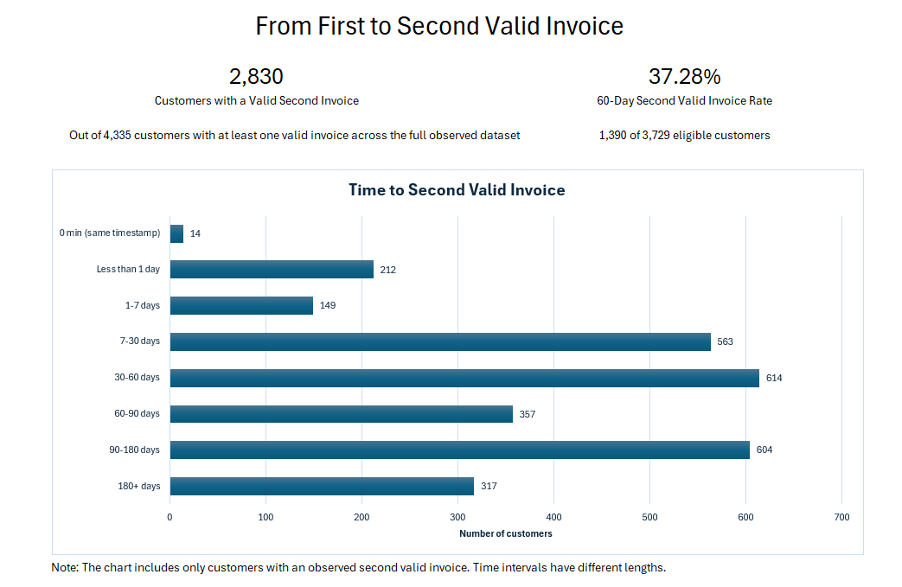

# From First to Second Valid Invoice

## Executive Summary

We wanted to find out the proportion of customers who registered a second valid invoice within a 60-day window. We did this by first identifying valid invoices and then checking which customers had at least 60 days of observation available in the dataset. We found that **37.28% of the 3,729 eligible customers** had a second valid invoice within 60 days. A possible next step is to compare the products purchased and the amount spent on the first valid invoice between eligible customers who had a second valid invoice within 60 days and those who did not. This could help the business better understand differences between these groups and plan future retention strategies.

## Dashboard

## Business Problem

An online retail business has records of customer sales and invoices. However, knowing the total number of invoices does not show what proportion of customers register a second valid invoice. The goal of this analysis is to measure that proportion within a defined observation window and examine the time between customers' first and second valid invoices.

## Project Overview

This project analyzes transaction data from an online retail store in the United Kingdom, recorded between late 2010 and late 2011.

**Data source:** [UCI Machine Learning Repository — Online Retail](https://archive.ics.uci.edu/dataset/352/online+retail). Prices are recorded in GBP.

**Tools used:** Excel, Power Query, and Pivot Tables

## Key Results

| Observation Window | Eligible Customers | Customers with Second Valid Invoice | Rate |
|---|---:|---:|---:|
| 30 days | 4,067 | 891 | 21.91% |
| 60 days | 3,729 | 1,390 | 37.28% |
| 90 days | 3,369 | 1,593 | 47.28% |

I selected the 60-day rate as the main KPI. The 30-day and 90-day rates provide additional context about how the results change across observation windows.
Each rate uses its own eligible customer population.

## Business Findings and Recommendations

### Key Findings

The analysis shows that 37.28% of the 3,729 eligible customers had a second valid invoice within 60 days of their first valid invoice.

For the 2,830 customers who had a second valid invoice, the median time between their first and second invoices was about 51 days.

The time between invoices was different across customers. Also, the dashboard shows time ranges of different lengths, so the number of customers in each range should not be compared as if they were rates.

### Recommendations

A next step could be to compare customers who had a second valid invoice within 60 days with those who did not.

We could look at the products they bought and how much they spent on their first valid invoice to see if there are any differences between these groups. This information could help the business plan future customer retention strategies.

However, this analysis does not explain why customers returned or show whether a retention campaign would work.

## Data Preparation and Methodology

### Data Preparation

I downloaded the original Online Retail dataset, which contained **541,909 transaction lines**. In Power Query, I created a query to keep only records with an identified `CustomerID`, since I need to track each customer's invoices over time. After filtering, **406,829 lines** remained.

### Exploratory Data Analysis

I initially explored time intervals between consecutive invoices using indexed queries, a left join in Power Query, and pivot tables. This preliminary analysis helped me identify potential data-quality issues, including cancellations and invoices recorded within short time intervals. These preliminary results were not used to calculate the final second valid invoice rates.

### Valid Purchase Classification

I created another query to investigate which conditions a transaction line should meet to count as evidence of a valid purchase-related transaction.

I established some conditions: the `InvoiceNo` must not start with `C`, `Quantity` and `UnitPrice` must be greater than zero, and `StockCode` must not equal special codes such as `D`, `POST`, `C2`, `DOT` or `M`.

I created a column called `Valid_Line` to classify these records as `Yes` or `No`. After grouping and counting the results, I obtained **396,352 lines classified as `Yes`** and **10,477 as `No`**. I also checked examples involving cancellations, zero-priced products, and an invoice containing both priced product lines and a shipping charge.

### Valid Invoices and Second Invoice Analysis

After applying my classification rules, I identified 18,413 valid invoices and 4,335 customers with at least one valid invoice.

Of these customers, 2,830 had an observed second valid invoice during the dataset period.

To calculate the second valid invoice rates, I used observation windows of 30, 60, and 90 days. Only customers with enough observation time were included in each window.

## Limitations and Assumptions

The analysis has some methodological limitations, including short intervals between valid invoices, customers without valid invoices, and differences in observation time.

These decisions and limitations are documented in [Business Rules v0.1](docs/business_rules_v0.1.md).

## Reproducing the Analysis

**Download the workbook:** [Online_Retail_Analysis_Public.xlsx (v1.0)](https://github.com/mbonalesr/online-retail-repeat-purchase-analysis/releases/download/v1.0/Online_Retail_Analysis_Public.xlsx)

The original Online Retail dataset is available from the UCI Machine Learning Repository. The raw dataset is not included in this repository.

To reproduce the analysis:

1. Download the original Online Retail dataset from UCI.
2. Open `Online_Retail_Analysis_Public.xlsx` in Microsoft Excel with Power Query.
3. Open the Power Query Editor and locate `Online_Retail_Raw` and `Raw_Row_Count`.
4. In both queries, select the `Source` step and update the path inside `File.Contents()` to point to the downloaded dataset. The source workbook should contain a worksheet named `Online Retail` with the original eight columns.
5. Select **Close & Load**, then **Data → Refresh All**.

After refreshing, verify the main results:

- Original records: 541,909.
- Customers with an observed second valid invoice: 2,830.
- 60-day second valid invoice rate: **37.28%**.

**Reproducibility note:** I tested the workbook on a second computer by updating both source paths. The main results remained consistent, although one exploratory query reported an incomplete load.
